<p align="center">
  
</p>

<p align="center">
  
</p>

<p align="center">
  <a href="https://linkedin.com/in/samrat-patel"></a>
  <a href="mailto:patel.samrat2000@gmail.com"></a>
  
</p>

<h2 align="center">▙ COMMIT LOG ▟</h2>

<p align="center">
  <a href="https://github.com/samrat2825?tab=repositories">
    
  </a>
</p>

<p align="center">
  
  
  
</p>

<p align="center"><sub>Counts come from GitHub's contribution API, public and private, and a scheduled Action redraws the panel every night.</sub></p>

<br/>

```text
┌─[ samrat@updraft ]─[ ~/payments ]
│
│  4+ years building fintech backends that have to stay up.
│  At Updraft (UK, FCA-authorised, 800k+ users) I own two core
│  Python/Django services: the payments API (1.7M+ transactions)
│  and the loan management system (145k+ accounts). Both run
│  serverless on AWS Lambda with EventBridge driving async work.
│
│  Things I care about: reliability, observability, boring
│  architecture that survives a 3am page.
│
└─$ _
```

<h2 align="center">▙ LOADOUT ▟</h2>

<p align="center">
  
  
  
  
  
  <br/>
  
  
  
  
  
  
  <br/>
  
  
  
  
  
  <br/>
  
  
  
  
</p>

<h2 align="center">▙ RUN HISTORY ▟</h2>

```text
[2023-09 → now ]  SOFTWARE ENGINEER ░ Updraft ░ Delhi
  ├─ 13-microservice AWS platform, 16-18M Lambda invocations a day
  │    (p95 600ms, p99 1.05s)
  ├─ Payments API: 25k transactions/day peak, 1.7M+ total
  ├─ Loan management for 145k+ accounts
  ├─ NOSIA: FCA compliance pipeline for 70k active loans,
  │    automated arrears calculators
  ├─ Catch-up payment scheduling that lifted recovery by 20%
  ├─ Self-hosted AI orchestration platform on ECS/Fargate via Terraform
  └─ Cut $10k/year from staging: consolidated environments,
       private IP routing

[2022-04 → 2023-07]  SOFTWARE DEVELOPMENT ENGINEER ░ Amigo Softcom ░ Gurugram
  ├─ GitHub Actions CI/CD from scratch; 2-3 production releases a day
  ├─ Go (Mux) REST APIs wiring Shopify, WooCommerce and
  │    Google Analytics for 10+ D2C brands
  └─ JSON-driven backend UI rendering that cut frontend turnaround by 80%

[2021-07 → 2022-03]  SOFTWARE ENGINEER, FULL-STACK ░ Creed Essential ░ New Delhi
  ├─ Led a team of 7 on a Next.js + Firebase consumer platform
  │    with SSR and PWA support
  └─ Firestore schema redesign, 30% lower query latency on the
       React Native app
```

<h2 align="center">▙ CREDENTIALS ▟</h2>

```text
EDU   Delhi Technological University ░ B.Tech, Computer Engineering
      2018-2022 ░ CGPA 8.60/10
PUB   Healthcare 5.0: Improving Personalised Care using Blockchain and AI
      6th International Conference, 2022
CERT  Machine Learning Specialisation ░ Deep Learning Specialisation ░ Andrew Ng
MISC  Cleared the National Defence Academy exam (top percentile)
```

<h2 align="center">▙ TELEMETRY ▟</h2>

<p align="center">
  
</p>

<h2 align="center">▙ OPEN CHANNEL ▟</h2>

<p align="center">
  Looking for backend or platform roles in fintech, payments, or high-scale distributed systems.<br/>
  <a href="mailto:patel.samrat2000@gmail.com">patel.samrat2000@gmail.com</a> · <a href="https://linkedin.com/in/samrat-patel">linkedin.com/in/samrat-patel</a> · Delhi, India
</p>

<p align="center">
  
</p>
